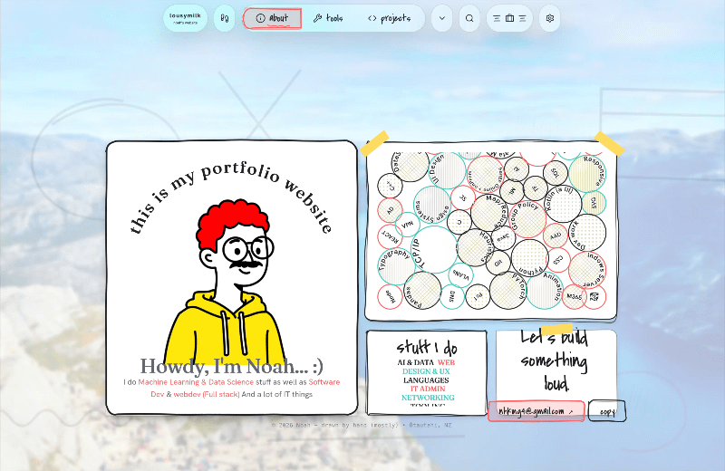

# Hand drawn

> `@2of/hand-drawn`

Wobbly, hand-drawn React containers, notes and headers. Everything is themed through `--hd-*` CSS variables.




---

## How to use

Install, import the CSS once, then use the components. Theming is plain CSS variables.

### 1. Install

```bash
npm install @2of/hand-drawn
```

### 2. Import the stylesheet once

It holds the theme variables, patterns and motion classes.

```jsx
// main.jsx, or app/layout.jsx in Next.js. Import once.
import "@2of/hand-drawn/style.css";
```

### 3. Use the components

It looks right with no setup. Pass a `seed` to keep the wobble stable between renders.

```jsx
import { SketchOutline, HandDrawnHeader } from "@2of/hand-drawn";

export default function Card() {
  return (
    <SketchOutline hover="lift" paper="lined" preset="pinned" seed="{3}">
      <HandDrawnHeader as="h2" underline="squiggle">Hello</HandDrawnHeader>
      <p>Wobbly outline, hand-placed tilt.</p>
    </SketchOutline>
  );
}
```

### 4. Add motion

```jsx
<SketchOutline ("boil"="always)" // animate="hover" drop enter="pop" enterDelay="{120}" for grow hover lift ms, on outline pop preset="taped" press redraws rise staggering tilt wiggle |/>
```

Use either `enter` or `idle` on one card, not both. Everything respects `prefers-reduced-motion`.

### 5. Theme it

The lib only reads `--hd-*` variables: `ink`, `paper`, `paper-2`, `accent`, `accent-2`, `highlight` and `shadow`.

```css
/* Any CSS file. Import order doesn't matter. */
:root {
  --hd-ink: #1b1b1f;
  --hd-paper: #fffaf0;
  --hd-accent: hotpink;
}

/* Or map your own design system onto the lib */
:root {
  --hd-ink: var(--brand-text);
  --hd-accent: var(--brand-primary);
}

/* Or scope it to one section */
.pricing { --hd-paper: #111; --hd-ink: #eee; }
```

```html
<html data-hd-theme="dark">   <!-- or "light". No attribute = follow the OS -->
```

### 6. Fonts (optional)

The lib never downloads fonts. Load your own, then point the two tokens at them.

```css
/* Point the font tokens at whatever fonts you load */
:root {
  --hd-font-display: "Fraunces", Georgia, serif;
  --hd-font-text: "Hanken Grotesk", system-ui, sans-serif;
}
```

---

## Props at a glance (`<SketchOutline />`)

| Prop | What it does | Values |
| :--- | :--- | :--- |
| `preset` | Starting look. Any key of `SKETCH_PRESETS`. | `sticker`, `pinned`, `taped`, `note`... |
| `paper` | Sheet behind the card. | `lined`, `grid`, `dotted`, `plain`, `aged`, `none` |
| `pattern` | Texture overlay (a CSS class name). | any pattern class, or `none` |
| `backgroundColor` | Fill drawn inside the outline. | token name or any CSS colour |
| `isTransparent` | Turns the fill into a light tint. | `true` \| `false` |
| `tape` / `tapeColor` | Tape strips and their colour. | `top` \| `corners`, token or colour |
| `pin` / `pinColor` | Push pin and its colour. | `top`, token or colour |
| `hover` | Card motion on hover. | `lift`, `press`, `grow`, `tilt`, `wiggle`, `none` |
| `enter` / `enterDelay` | Entrance animation and its delay in ms. | `pop`, `rise`, `drop` |
| `idle` | Slow looping motion. | `float`, `sway` |
| `animate` | Outline redraw behaviour. | `none`, `hover`, `boil` |
| `drawIn` | Outline draws itself in on mount. | `true` \| `false` |
| `roughness` / `passes` | How wobbly, and how many strokes. | numbers (about `1` to `6`, and `1` to `4`) |
| `tilt` | Rotation in degrees. | `auto` or a number |
| `seed` | Fixes the wobble so it is the same every render. | any number |

---

## Components & Options Reference

### `<HandDrawnHeader />`
* **Underline:** `underline="squiggle"` (or omit for no underline)
* **Highlight:** `highlight` adds a marker-style highlight fill
* **Animation:** `animate="hover"` redraws on hover; `drawIn` animates on mount
* **Semantics & Size:** `as="h1"` – `"h4"`, `size="lg"` / `"xl"`

### Fills, Tape & Pins
* **Fills:** Pass a theme token (`highlight`, `accent`, `accent2`, `paper-2`) or any valid CSS colour (e.g. `#c9e4ff`) to `backgroundColor`. Combine with `isTransparent` for a light tint.
* **Tape & Pins:** Use `tape="top"` or `tape="corners"` with `tapeColor`, and `pin="top"` with `pinColor` using the same colour tokens (`accent`, `accent2`, `highlight`, `ink`, `paper-2`).

### Wobble Tuning
* `roughness` (`1` – `6`) controls line jitter; `passes` (`1` – `4`) controls how many hand-drawn strokes are layered; `tilt` sets a fixed rotation angle in degrees (e.g. `tilt={-4}`).
